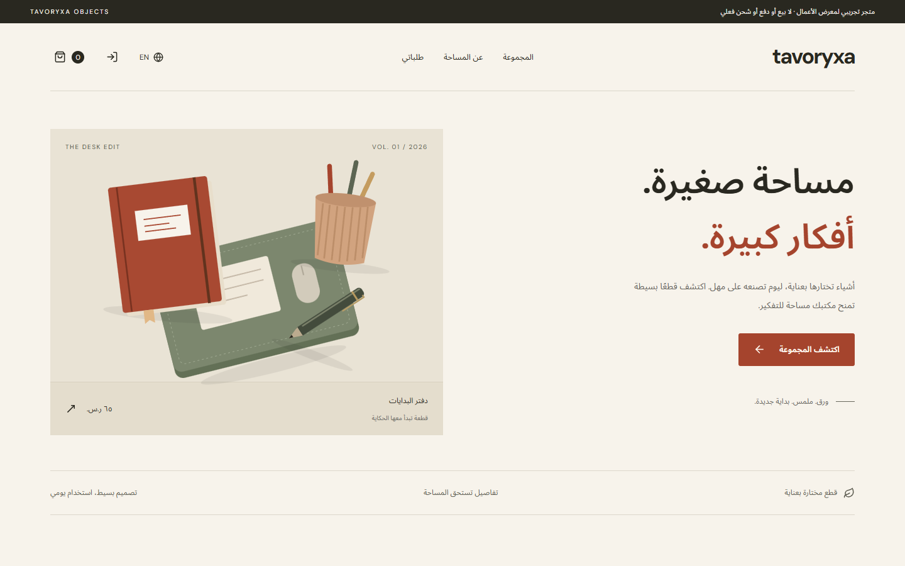

# Tavoryxa — مساحة ليومك / Make room for your day

[](https://github.com/abomosaa/tavoryxa/actions/workflows/ci.yml)

**Local upgrade — 2026-10-23, not yet deployed:** dedicated product routes, generated-photo gallery/detail crop/enlargement, quantity choices, a device-local wishlist and detailed order history/re-add are implemented. Eight IDs/prices and old orders are preserved; no SQL migration is needed. Commerce facts are pending, so checkout still saves simulated records only. [Upgrade scope](UPGRADE.md) separates this local work from the deployed release below.

<div dir="rtl" align="right">اكتملت توسعة المصدر المحلي بصفحات منتجات ومعرض صور مولدة وتكبير وخيارات كمية ومفضلة لهذا الجهاز وتفاصيل الطلبات وإعادة الإضافة. لم تُنشر التوسعة بعد؛ بقيت المعرّفات والأسعار والطلبات محفوظة دون ترحيل SQL. بيانات التجارة الفعلية معلقة، لذلك يبقى إنشاء الطلب تجريبيًا عند تأكيده. حالة النشر السابقة موثقة أدناه.</div>

**Current verified status — 2026-10-23:** the main agent completed real Google OAuth with the user's authorized account and returned to this storefront. A **simulated** cloud order `#B8290AF4` (one notebook, SAR 83 total) survived reload and appeared in the signed-in order history. Signing out restored the guest history containing local order `#68DA4835`; the cloud order was absent there. No charge or shipment occurred. Email delivery remains unverified and its gate is false; GitHub remains disabled. The user deferred Brevo setup.

**Deployed source release — 2026-10-22:** authentication update deployed from [commit 5bfbfb1](https://github.com/abomosaa/tavoryxa/commit/5bfbfb1), Cloudflare version `5f9b5286-19b1-4c58-8482-6afe12e03efb`; [CI run 39772228693 passed](https://github.com/abomosaa/tavoryxa/actions/runs/39772228693). The main agent completed source review, including the immutable recovery Bearer and 15-second request timeout. At that release checkpoint, live email/OAuth had not yet been verified and both OAuth providers were disabled.

<div dir="rtl" align="right">

**الحالة المتحققة في 23 أكتوبر 2026:** أكمل الوكيل الرئيسي دخول Google الحقيقي بالحساب الذي اختاره المستخدم وعاد إلى المتجر الصحيح. حُفظ الطلب السحابي **التجريبي** `#B8290AF4` لدفتر واحد بإجمالي 83 ريالًا، وظهر بعد إعادة التحميل. بعد تسجيل الخروج ظهر الطلب المحلي السابق `#68DA4835` فقط في سجل الضيف دون الطلب السحابي. لا دفع أو شحن حقيقي. البريد غير متحقق وبوابته معطلة، وGitHub معطل؛ أجّل المستخدم إعداد Brevo.

**إصدار المصدر المنشور في 22 أكتوبر:** `5bfbfb1` بالإصدار السحابي `5f9b5286-19b1-4c58-8482-6afe12e03efb` وCI ناجح رقم `39772228693`. اكتملت مراجعة المصدر وجلسة الاستعادة الثابتة ومهلة 15 ثانية. كان اختبار البريد وOAuth الفعلي وإعداد المزودين معلقًا عند تلك النقطة التاريخية.

اختير Brevo بحد 300 رسالة يوميًا ثم أُجّل إعداده بطلب المستخدم. يوجد مرسل موثّق بالفعل؛ ما زال ربط SMTP login وSMTP key مباشرة في Supabase واختبار الإرسال معلقين. لا تُوضع هذه البيانات في المصدر أو متغيرات الواجهة.

</div>

Brevo was selected with a 300-email daily allowance; setup is deferred by the user. An existing verified sender was observed; direct SMTP login/key configuration and delivery testing remain pending. No SMTP credentials belong in source files or frontend environment variables.

<div dir="rtl" align="right">

متجر عربي وإنجليزي لثمانية منتجات مكتبية، مع الفئات والبحث والترتيب وصفحات المنتجات والسلة والكمية والطلبات. يستخدم المصدر المحلي صورًا تصورية مولدة، مع الاحتفاظ برسومات SVG الأصلية عند تعذر تحميل الصورة. بيانات البيع الفعلي لم تكتمل؛ الطلب الحالي تجريبي ولا يجمع بيانات بطاقة أو عنوان.

**الخط الأساسي الأصلي:** نُشر المتجر على Cloudflare واستجاب الرابط العام بنجاح. نجح البناء وTypeScript والاختبارات التسعة وفحص المتصفح لمسار الطلب وحفظه وإعادة التحميل وتبديل اللغة والتجاوب عند 390 و820 و1440 بكسل. لم يظهر تجاوز أفقي أو أخطاء صفحة. طُبق SQL واختُبر عزل المستخدمين والأسعار. تفعيل دخول GitHub للزوار لم يكتمل بعد.

وضع الضيف يعمل دون إعداد: تحفظ السلة والطلبات في هذا المتصفح فقط. لا تُنقل الطلبات المحلية تلقائيًا إلى الحساب. الدخول عبر المزودين يحتاج إعدادهم والسماح بعنوان العودة؛ تُقرأ حالتهم الفعلية وقت التشغيل. فشل الطلب السحابي يظهر خطأ ولا يحفظ نجاحًا محليًا بديلًا.

</div>

A complete Arabic-first / English storefront with eight fictional desk objects, category/search/sort, persistent bag, simulated checkout and owner-isolated order history. Current local source uses generated concept photographs with original SVG failure fallbacks; the published checkpoint above predates that expansion. No real sales, card/address collection, charges or fulfillment.

Local routes: `#/product/notebook` (and the other seven stable IDs), `#/saved`, `#collection`, `#story`. Product links survive reload/browser history; missing IDs have a recovery page. Wishlist contains product IDs only and stays on this device without account sync. Re-add uses current catalogue prices and caps quantities at 20 without changing saved prices/totals. No alternative colour/size SKUs or stock counts are invented. Responsive photo sources serve 480/960px product images and 768/1536px hero images, with larger gallery/zoom size hints.

Original baseline: published on Cloudflare with a successful public HTTP response. Build, TypeScript, nine cart/checkout/storage tests, browser checkout + persistence + bilingual/mobile navigation passed; no page errors or horizontal overflow at 390/820/1440px. Live SQL isolation/trusted-price assertions passed. Visitor GitHub provider setup remains pending.

[Live demo / العرض المباشر](https://tavoryxa.qirvexa.workers.dev) · [Source / المصدر](https://github.com/abomosaa/tavoryxa)

**Authentication coverage:** email/password sign-in, confirmation-gated signup, forgot/reset password, and runtime Google/GitHub visibility are implemented and locally verified. Real Google OAuth is now verified for the authorized account; email delivery and GitHub remain external checks. Google is still in **Testing**; this does not claim In Production publishing or verified branding. Google's [basic-identity exception](https://support.google.com/cloud/answer/15549945?hl=en) allows identity-only requests without the test-user list or seven-day authorization expiry; additional scopes fall outside that exception.

<div dir="rtl" align="right">

**تغطية الحسابات:** النماذج وإظهار المزودين حسب إعدادهم ضمن الإصدار المنشور بعد الاختبارات المحلية. تحقق دخول Google فعليًا بالحساب المصرح به؛ البريد وGitHub لم يُتحققا. يبقى تطبيق Google في حالة Testing دون ادعاء النشر In Production أو توثيق العلامة. استثناء الهوية الأساسية المرتبط أعلاه يعفي طلبات الهوية فقط من قائمة المختبرين وانتهاء التفويض بعد سبعة أيام؛ لا يشمل الصلاحيات الإضافية.

</div>



## Run / التشغيل

```powershell
npm ci
npm run dev
npm run typecheck
npm test
npm run build
npm run format:check
```

`npm run format` formats source, QA scripts and primary configuration/docs with pinned Prettier 3.9.10. CI checks formatting before type checks/tests/build. Development tools are pinned to patched Vite 7.3.7, Vitest 4.1.12 and Wrangler 4.151.3; the full dependency audit and production-only audit reported zero findings on 2026-10-22.

الأمر `npm run format` ينسق المصدر وملفات الاختبار والإعداد والتوثيق، ويفحص CI التنسيق قبل بقية التحقق. حُدثت الأدوات المتأثرة أمنيًا فقط؛ أظهر التدقيق الكامل وتدقيق الإنتاج صفر ثغرات في 22 أكتوبر 2026.

Node 22.12+ or Node 24 recommended. Copy `.env.example` to `.env.local` for cloud mode, populate browser-safe Supabase URL/publishable key, and rebuild. Never put `service_role`, secret keys or OAuth secrets in Vite environment variables.

تُنسخ `.env.example` إلى `.env.local` عند تفعيل السحابة. متغيرات Vite عامة للمتصفح؛ لا توضع فيها مفاتيح سرية.

| Variable                        | Meaning / المعنى                                                                                                                                          |
| ------------------------------- | --------------------------------------------------------------------------------------------------------------------------------------------------------- |
| `VITE_SUPABASE_URL`             | New approved shared project URL / عنوان المشروع الجديد المعتمد                                                                                            |
| `VITE_SUPABASE_PUBLISHABLE_KEY` | Public browser key only / المفتاح العام فقط                                                                                                               |
| `VITE_EMAIL_DELIVERY_ENABLED`   | Defaults to `false`; enable only after real confirmation/reset mail delivery is verified / يبقى معطلًا حتى التحقق الفعلي من وصول رسائل التأكيد والاستعادة |

## Cloud contract / ربط السحابة

- Apply `supabase/001_tavoryxa.sql` once to the approved NEW project. It creates only `tavoryxa_*` tables and `tavoryxa_private` functions.
- Public catalogue: `tavoryxa_products` is read-only for visitors/users. Prices are integer halalas.
- Orders: authenticated owner-only SELECT, no direct public INSERT/UPDATE/DELETE. Public invoker RPC calls a private-schema definer writer with fixed empty search path and explicit `auth.uid()` check.
- `tavoryxa_create_order(p_items, p_name, p_request_id)` accepts only product IDs/quantities and a display name/request UUID. The database derives canonical prices/delivery/total, atomically creates order and lines (JSON), and returns an idempotent record for retries. No caller-supplied user ID/status/price accepted.
- Email sign-in uses the existing Supabase client. Google/GitHub buttons appear only when `GET /auth/v1/settings` confirms their exact `external` flag is `true`; failures default to unavailable. No provider secrets enter the browser. The former `VITE_GITHUB_AUTH_ENABLED` switch is no longer used.
- New email registration/reset requests require both the public email-provider flag and `VITE_EMAIL_DELIVERY_ENABLED=true`; signup also honors `disable_signup`. Ordinary email/password sign-in remains usable when the email provider is enabled. Email confirmation is not disabled or bypassed.
- OAuth/signup callbacks target the current origin's `/`; reset requests target the current origin's `/?auth=recovery`. Root must allow the actual deployed and local callback URLs and configure provider callbacks in the external consoles.
- On 2026-10-23, the first storefront callback fell back to Qirvexa because the trailing-slash origin was not allowlisted. The main agent saved six exact Supabase redirect URLs (the previous four plus both deployed origins with `/`), then verified return to `https://tavoryxa.qirvexa.workers.dev/`. Backend schema, IP and SMTP settings were unchanged during this retest.
- The singleton client uses PKCE. A module-level listener captures only a genuine SDK `PASSWORD_RECOVERY` event before React mounts; a URL marker or ordinary session never grants access to password update. Reset links must be opened in the browser that initiated the request.
- Password mutation is deliberately bound to the recovery event's immutable owner/access token with `PUT /auth/v1/user`, public `apikey`, and that captured Bearer. A pre-dispatch current-grant check stops known stale requests; a later cross-tab singleton-session change cannot change the request's owner. The grant is held only in memory and cleared after success/sign-out/ordinary sign-in. Do not replace this with a mutable-session `auth.updateUser()` call without equivalent owner binding.
- There is no custom Worker API. The client uses Supabase REST/RPC and Auth. `wrangler.jsonc` serves `dist` assets with SPA fallback. Main agent owns deployment/resource authorization.

<div dir="rtl" align="right">

تُطبّق SQL مرة واحدة على المشروع الجديد فقط. الكتالوج للقراءة، والطلبات تُقرأ بصلاحية المالك فقط. إجراء الطلب يستمد الأسعار من قاعدة البيانات ويحفظ السطور والمجموع معًا؛ لا يسمح للمستخدم بتغيير المالك أو الحالة أو السعر. لا توجد واجهة API خاصة في Worker؛ يتصل المتصفح مباشرة بخدمات Supabase المصرح بها، ويقدّم Worker ملفات الموقع.

</div>

## Evidence / أدلة التحقق

- Main-agent live Google/cloud-order proof (2026-10-23): root-workspace `research-artifacts/tavoryxa-google-cloud-order.png`, intentionally outside this project's committed screenshot packet. The live check covered the correct callback origin, persisted simulated cloud order and guest/cloud history separation after sign-out.
- `qa/browser-results.json`: actual browser flow results. `qa/browser-check.cjs` can rerun with Playwright installed in the QA environment (or `PLAYWRIGHT_MODULE` set to an existing module path) and installed Edge. Default URL `http://127.0.0.1:5174`; override `BASE_URL`.
- `qa/flow/`: English desktop, Arabic checkout, mobile order screenshots.
- `qa/screenshots/capture/shots/`: initial AR 1440/820/390 screenshots.
- `qa/audit/`: Webforge audit after contrast/touch fixes: 98 overall, no high accessibility issues, no responsive findings. It heuristically missed the existing Arabic skip link. Remaining low/medium findings include tiny decorative labels, no public canonical/social metadata and font-count advice. This is a tool audit, not Lighthouse certification.
- `qa/auth-forms.cjs`: isolated AR/EN form regression, validation/no request on mismatch, safe errors, signup/reset/OAuth arguments, delivery gate, settings failure, forged recovery marker rejection, early recovery and update. `qa/auth-pkce.cjs`: actual installed SDK with every Auth request intercepted, generated verifier, callback exchange, early recovery event, fixed-owner password update and URL cleanup. These fixtures do not prove live mail or OAuth delivery.
- Current unit suite: 19 passing tests, including settings fail-closed, password matching, fixed-owner recovery guards, safe routes/wishlist and historical-price preservation. `qa/auth/` contains inspected mobile auth screenshots.
- `qa/storefront.cjs` and `qa/upgrade/results.json`: all eight photos, fixed 16px arrow, routes/gallery/crop/zoom/focus, quantity/wishlist, saved-order detail/re-add, missing route and image-failure fallback; AR/EN at 390/820/1440px. This fixture blocks external traffic. `qa/upgrade/` contains the upgrade screenshot packet.
- The current Impeccable detector reports design-system palette/type-ramp advisories against the incomplete/stale sidecar. Product record schema and sidecar advisories were reported without automatic repair; `DESIGN.md` remains visual authority. The earlier empty detector result predates that schema.

الدليل البصري وتقارير المتصفح محفوظة داخل `qa`. نتائج الأدوات لا تمثل اختبارًا يدويًا لكل تقنية مساعدة، ولا تثبت عمل OAuth أو النشر قبل اختباره فعليًا.

## Reuse / إعادة الاستخدام

Replace names/artwork/catalogue, update SQL seeded catalogue consistently, then provide the new project environment and redirect URLs. Local cart/order keys and Supabase auth storage are prefixed `tavoryxa`. Do not reuse a real store's privacy/payment claims without implementing them.

يمكن إعادة تخصيص الاسم والمنتجات والرسومات، مع تحديث كتالوج قاعدة البيانات بما يطابق الأسعار المعروضة. مفاتيح التخزين معزولة باسم المشروع. لا تُستخدم ادعاءات متجر فعلي قبل تنفيذ متطلباته.

Auth isolation regression: `qa/auth-isolation.cjs` substitutes a browser-only Supabase module and verifies stale getUser/order/checkout responses and corrupt local history. It makes no live backend calls. مراجعة عزل الحساب تستخدم بديلًا محليًا داخل المتصفح دون اتصالات سحابية فعلية.

نماذج الحسابات عربية وإنجليزية، ولا تحفظ كلمات المرور أو تعرض أخطاء الخادم الخام. اختبارات الاستعادة تربط التغيير بمالك الجلسة التي صدرت لها الاستعادة، وتمنع نتيجة حساب قديم من الظهور في حساب آخر. اختبارات المتصفح تستبدل الشبكة ببيانات تجريبية ولا تثبت وصول رسالة أو نجاح تسجيل Google الفعلي.
