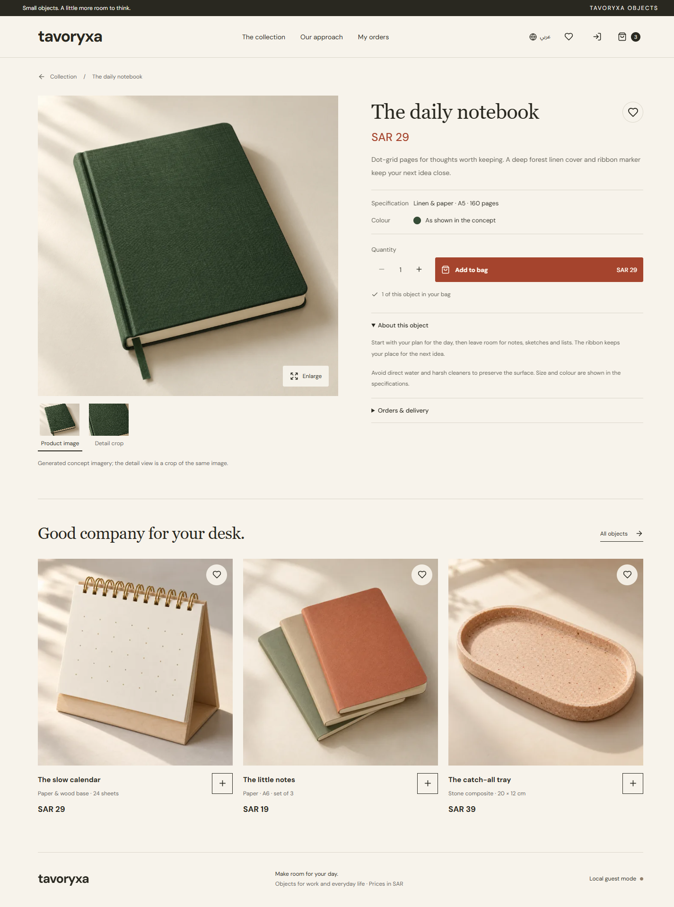

Tavoryxa — مساحة ليومك

"زيارة المتجر | Visit Store" (https://tavoryxa.qirvexa.workers.dev)

نبذة عن المشروع

Tavoryxa متجر إلكتروني عصري للمنتجات المكتبية، يجمع بين البساطة والأناقة وتجربة تسوق سلسة باللغتين العربية والإنجليزية.

يتميز بتصميم دافئ ومتجاوب يناسب الجوال والكمبيوتر، مع اهتمام بالتفاصيل وسهولة الاستخدام.

المميزات

- عرض المنتجات مع معرض صور تفاعلي وتكبير التفاصيل.
- البحث والتصفية حسب الفئات وترتيب المنتجات.
- سلة تسوق تفاعلية مع التحكم بالكميات.
- قائمة مفضلة وسجل للطلبات.
- مجموعات مكتبية مختارة لتسهيل التسوق.
- تسجيل الدخول باستخدام Google.
- حفظ بيانات المستخدم ومزامنة الطلبات عبر Supabase.
- حركات وانتقالات سلسة مع دعم تقليل الحركة.
- دعم كامل للعربية والإنجليزية.

التقنيات

React · TypeScript · Supabase · Playwright

التشغيل محليًا

npm ci
npm run dev

لإعداد قاعدة البيانات، راجع ".env.example" وملفات "supabase/".

«المتجر حاليًا في مرحلة العرض، وتتوفر تجربة إنشاء الطلبات دون معالجة مدفوعات فعلية.»

---

About Tavoryxa

Tavoryxa is a modern bilingual storefront for thoughtfully selected desk essentials, combining elegant design with a smooth shopping experience.

Features

- Interactive product galleries with image zoom.
- Product search, filtering, and sorting.
- Shopping cart with quantity controls.
- Wishlists and order history.
- Curated desk collections.
- Google authentication and Supabase integration.
- Responsive design for mobile and desktop.
- Smooth animations with reduced-motion support.
- Full Arabic and English support.

Getting Started

npm ci
npm run dev

Configure the environment using ".env.example".

Checkout is currently available in demonstration mode without live payment processing.

---

"Tavoryxa Product Page" (qa/refinement/product-en-desktop.png)

